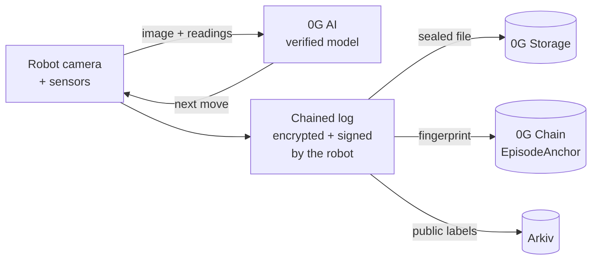
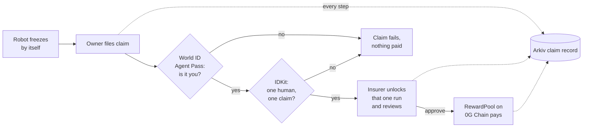
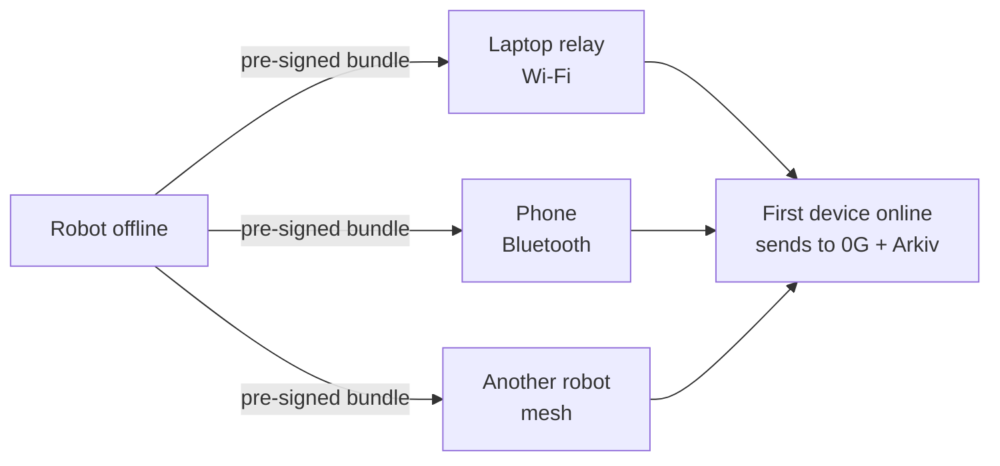

# Pearl

**A tamper-proof black box for robots.**
An AI on 0G decides each move. The robot seals and signs its own record. After an accident, only a verified human can claim the insurance payout.

| | |
|---|---|
| Live app | https://pearl-robotics.vercel.app |
| Repo | https://github.com/Divyab7/pearl |
| Demo video | link added on submission |
| Licence | [MIT](LICENSE) |

> The backend runs on a free server that sleeps. If the app shows "Waking up the server", wait about 30 seconds.

---

## Problem

Robots are leaving cages and working next to people: in warehouses, kitchens and labs. When one hits something or someone, three questions come up:

- **What happened?** Robot logs sit on the maker's or owner's computer. Anyone can edit them after the fact.
- **Who decided?** AI now chooses the robot's moves, but nobody can prove which model decided what, or that it wasn't changed.
- **Who gets paid?** Insurers can't trust the logs, so claims are slow, manual and easy to fake. A bot can file a claim as easily as a person.

## Solution

Pearl is a flight recorder for robots, with insurance built in.

1. **0G AI decides.** At each step the robot sends its camera image to an AI model on 0G. The answer is verified (it runs in secure hardware). No valid answer means the robot stops safely. It never invents one.
2. **The robot keeps its own record.** Every decision and camera frame goes into a chained log. The robot encrypts it, signs it with its own key and stores it on **0G Storage**. A fingerprint goes on **0G Chain**.
3. **Anyone can check it.** The robot writes a public entry for each run on **Arkiv**. A proof link lets anyone confirm the record is untouched without being able to read it. Change one byte and the check fails.
4. **Only a real human can claim.** After an incident, the owner claims with **World ID**: a fresh check that it is really them (Agent Pass) and proof they are one unique human (IDKit). The insurer reviews and approves. A contract on 0G Chain pays a fixed amount by severity.
5. **Works offline.** With no internet, the robot pre-signs its transactions. A laptop, a phone over Bluetooth or another robot carries them to the first device that is online. Carriers can't read or change them.

---

## How it works

### One robot run



### After an accident



### No internet



### Safety comes first

The robot's own safety loop runs on the board and never waits for the network:

| Trigger | What the robot does |
|---|---|
| Hand in the work zone (distance sensor) | freezes the arm |
| Knock to the base (motion sensor) | trips, then the AI rates how bad it was |
| Lost connection (heartbeat) | goes to a safe pose |
| 0G down or a bad answer | stops and logs "no decision" (`failsafe`) |

---

## How each track is covered

### 0G: Physical AI, agents with a body

| What the track asks | What Pearl does |
|---|---|
| 0G AI inside the control loop | Every step calls the 0G Compute Router with the camera image. The arm waits for the answer. Model `0gm-1.0-35b-a3b`. |
| Verifiable AI | Trust mode `verified` with the secure-hardware (TEE) check. An unverified answer counts as a failure. |
| Logs on 0G Storage | The whole run log and camera frames are stored encrypted. Each decision keeps its 0G request id. |
| On-chain proof | `EpisodeAnchor` on 0G Chain stores each run's fingerprint, once, under the robot's own address. |
| Real body | ESP32-S3 robot arm, plus a MuJoCo physics simulation whose camera image is what the AI sees. |
| Honest fallback | Other 0G vision models are tried if the provider fails. If everything fails, the robot stops. Every attempt is recorded. |
| zerobot | The arm is registered in 0G's zerobot registry. Runs can start from a zerobot command. |
| Payouts | `RewardPool` on 0G Chain pays approved claims after re-checking the anchor. |

### Arkiv

Arkiv is Pearl's public, searchable database. Nothing private goes in it.

| Record | Written by | Purpose |
|---|---|---|
| `pearl.episode.v2`, one per run | the robot, with its own wallet | find runs and incidents by robot, outcome or severity |
| `pearl.claim.v1`, one per claim | the insurer desk wallet | live claim status, updated at every step |

- The owner's run list, incident filter, home counters, claim status and the insurer's queue are all live Arkiv queries.
- Records hold labels only: no names, no World ID data, no keys, no run content.
- Offline robots pre-sign their Arkiv writes, so a carrier can deliver them later.
- Anyone can run this query (no key needed). It returns the robot's incidents, newest first:

```bash
curl -s https://rpc.rabdi.db-chain.testnet.arkiv.network -H 'content-type: application/json' --data @- <<'EOF'
{"jsonrpc":"2.0","id":1,"method":"arkiv_query","params":["arkiv.schema = str('pearl.episode.v2') AND kind = str('incident') AND $owner = addr(0x5d3e957cC135CB23b344EF9b3A342Ae62982B1E1) ORDER BY ts:u64 DESC",{"select":{"key":true,"owner":true,"attributes":true},"limit":"0xa"}]}
EOF
```

### World: Agent Pass and IDKit

The protected action is **an insurance payout**.

| Check | Why |
|---|---|
| **Agent Pass** (World ID sign-in, re-checked at each claim) | proves the person approving the claim is the account owner, right now |
| **IDKit Proof of Human** (action `claim-<run>`, signal = payout wallet) | one human, one claim per incident; bots and duplicate accounts can't claim twice |
| Contract-level limit | RewardPool also pays each incident and claimant only once |

Wrong person, expired check, reused proof or wrong wallet: the claim fails and nothing is paid.

---

## Live proof

Real runs on 0G Galileo testnet, 6 Nov 2026:

| Run | 0G Storage | 0G Chain anchor | Arkiv entry |
|---|---|---|---|
| Normal pick, `DONE` | [tx](https://chainscan-galileo.0g.ai/tx/0xf85255400202e37bd5da43e32b6bfc86d06fb83bc1739d5e8bdbff1ca9c77272) | [tx](https://chainscan-galileo.0g.ai/tx/0x72d9e82f6857ba97d3840a0f77d90b07d42c49d41f09644b4692e629e7f057c3) | [entity](https://rabdi.explorer.arkiv.network/entity/0x39fa28cdbcbce18c79267ca68cde5003f0b337def6dec64a2b88660755c1348a) |
| Bump incident, `TRIPPED`, severity 2 | [tx](https://chainscan-galileo.0g.ai/tx/0xa1723e678ca5976d094b76312395cf10bbebdefde38fb3daf762ddc2b436e4c1) | [tx](https://chainscan-galileo.0g.ai/tx/0xff878c5447eb060b4cb53dfeb9804929955f98a2cbeaa9e4c0694e1570d77f65) | [entity](https://rabdi.explorer.arkiv.network/entity/0x5414ff68d6f9e693dcf5af321c2791068ebef0500bd7873ca971badec23794c1) |
| Started by a zerobot command | [tx](https://chainscan-galileo.0g.ai/tx/0x8d8a5bb822e8f40f15857718d8b5c3a0efc4a9b64358a49416c12d6b366f5de2) | [tx](https://chainscan-galileo.0g.ai/tx/0x8354c7de0c0d4848defe1279945eb859a3b542904677ad05aa76640d19a0e349) | [entity](https://rabdi.explorer.arkiv.network/entity/0x5ee97e94980669b567af6d597a6c994cc2762761f18cb88ad7626e59667a1111) |

### Contracts and wallets

| What | Network | Address |
|---|---|---|
| EpisodeAnchor (source-verified) | 0G Galileo, chain 16602 | [`0xD7f43CF89106Ca578f8Ccb03CBBBcfeeD5047446`](https://chainscan-galileo.0g.ai/address/0xD7f43CF89106Ca578f8Ccb03CBBBcfeeD5047446) |
| RewardPool (source-verified) | 0G Galileo | [`0xeec59Be297d33bf4DCE12c2F9aC8D2Ce69E571Bb`](https://chainscan-galileo.0g.ai/address/0xeec59Be297d33bf4DCE12c2F9aC8D2Ce69E571Bb) |
| Robot wallet (simulation) | 0G Galileo + Arkiv | `0x5d3e957cC135CB23b344EF9b3A342Ae62982B1E1` |
| Robot wallet (ESP32 board) | 0G Galileo + Arkiv | `0x29916Eaf4B0bcFc03508e49161376a466F2394a0` |
| Insurer desk / pool operator | 0G Galileo + Arkiv | `0xfBf57d9832D70f9f6c3E7E4f1D14239A1C171DA6` |
| zerobot RobotRegistry (0G's) | 0G Galileo | `0x291162e93D7A80Eb8F738882a28a7a8A5FBA73bb` |

Arkiv network: Rabdi testnet, chain 7794095.

---

## Try it

1. Open https://pearl-robotics.vercel.app.
2. **Insurer view:** pick the insurer demo workspace. Review a claim, unlock the run, approve it.
3. **Owner view:** pick the owner demo workspace. See runs, an incident and the claim steps.
4. **Tamper test:** on the landing page, choose "Try altering a record". Change one byte and watch verification fail.

Demo workspaces use clearly labelled sample data, so judges without World ID can try every screen. Real sign-in uses World ID.

---

## Business opportunity

- **Who pays:** insurers covering robots in warehouses, factories, hospitals and homes. Also robot makers and fleet operators who need records that will stand up in a liability dispute.
- **Why now:** AI is starting to control physical robots, and "the AI did it" will be a real legal question. Insurers need evidence nobody, including the owner, can edit.
- **What Pearl saves:** faster claims (the evidence is already sealed), less fraud (one verified human per claim) and less manual investigation.
- **How it earns:** a per-robot subscription for the black box, plus a fee per processed claim for insurers.
- **Next:** more robot types (mobile robots, drones), multi-owner fleets on the mesh, and insurer pilots.

---

## Technology

| Part | Built with |
|---|---|
| Robot hardware | ESP32-S3 N16R8, PCA9685 servo driver, 4 × MG90 servos, VL53L0X distance sensor, MPU6500 motion sensor, LED ring, buzzer, phone as camera |
| Firmware | C++ (PlatformIO, Arduino core 3): safety loop, motion, 0G call, encryption, signing, 0G Storage upload, Arkiv writes, Bluetooth mesh |
| Simulation | MuJoCo 3.3.7 physics arm (Python) and a TypeScript simulator, both speaking the board's protocol |
| Robot program and server | TypeScript, Node 22 |
| AI | 0G Compute Router: `0gm-1.0-35b-a3b`, falling back to `qwen2.5-vl-72b-instruct` and `gemini-2.5-flash-lite` |
| Storage and chain | 0G Storage SDK, Solidity contracts (Foundry) on 0G Galileo |
| Public index | `@arkiv-network/sdk` |
| Identity | World ID Agent Pass (OIDC), `@worldcoin/idkit-core` 4.6 |
| Encryption | AES-256-GCM per run, key wrapped with P-256 for the owner, robot signs with EIP-191 |
| Web app | React 19 + Vite, three.js arm view; Vercel (frontend) and Render (backend) |

### Privacy in one line each

- Run content is encrypted on the robot before upload. Only the owner holds the key.
- Filing a claim shares the key for **that one run** with the insurer, nothing else.
- Public records (Arkiv, chain) hold labels and fingerprints only.
- The server never signs robot data, so it can't fake a record.

---

## Run it locally

Needs Node 22+, pnpm, Python 3 (for MuJoCo) and PlatformIO (for the board).

```bash
pnpm install
cp .env.example .env        # add your own keys
pnpm -r build && pnpm test

pnpm device                 # robot program (:8070)
pnpm dev:backend            # server (:8080)
pnpm dev:dashboard          # web app, http://localhost:5173
```

MuJoCo arm instead of the simple simulator:

```bash
pnpm sim:mujoco:setup       # once
pnpm sim:mujoco
DEVICE=mujoco pnpm device
```

Flash the real board: `cd firmware/esp32-arm && pio run -e device -t upload`.

### Repo map

| Folder | What's inside |
|---|---|
| `apps/backend` | robot program, server, 0G, Arkiv, World ID, claims, offline relay |
| `apps/dashboard` | web app: landing, owner and insurer workspaces, Verify |
| `firmware/esp32-arm` | ESP32-S3 firmware |
| `sim/mujoco` | physics simulation |
| `contracts` | EpisodeAnchor and RewardPool |
| `prompts` | the instructions sent to the 0G model |

---

Built by Divya for ETHGlobal Mumbai 2026. How AI tools were used: [AI_USAGE.md](AI_USAGE.md).
